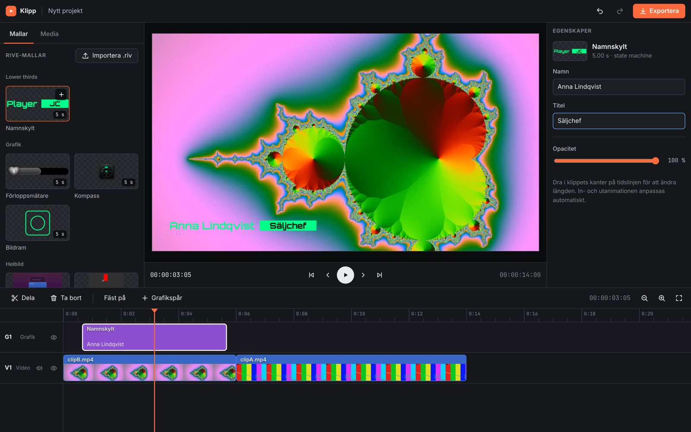

# Klipp – videoredigering med Rive-mallar i webbläsaren

En webbaserad videoredigerare där man klipper MP4-material och lägger på rörlig grafik från
**Rive-mallar** (ett öppet alternativ till MOGRT), med export till MP4. Allt körs lokalt i
webbläsaren. Ingen server och inget konto behövs.



## Funktioner (fas 0–2)

- **Import** av MP4 (H.264/AAC och det webbläsaren kan avkoda), bilder och egna `.riv`-mallar.
  Filer kan släppas var som helst i fönstret.
- **Tidslinje** med video- och grafikspår: dra in klipp, flytta, trimma, dela (`S`), ta bort
  (`Delete`, med `Shift` stängs luckan), fäst mot kanter och spelhuvud, zoom, och dölj eller tysta spår.
- **Mallbibliotek** med tumnaglar och live-förhandsvisning när muspekaren förs över en mall.
  Mallar dras in på tidslinjen eller läggs vid spelhuvudet med `+`.
- **Egenskapspanel** som byggs automatiskt från mallens View Model (data binding): text, färg
  (med projektets palett), bild, tal, av/på och val.
- **Förhandsvisning** med ljud, där ljudklockan styr uppspelningen.
- **Ångra och gör om** för allt (`⌘/Ctrl+Z`, `⌘/Ctrl+Shift+Z`). Skrivande i ett fält blir ett enda steg.
- **Export** till MP4 (H.264 + AAC 48 kHz stereo) i en Web Worker, med förlopp och möjlighet att
  avbryta. Exporten använder exakt samma renderingsfunktion som förhandsvisningen.

## Kom igång

```bash
cd video-editor
pnpm install
pnpm dev          # http://localhost:5173
```

Övriga kommandon:

| Kommando | Vad |
|---|---|
| `pnpm build` | Produktionsbygge till `apps/editor/dist` |
| `pnpm test` | Enhetstester (Vitest) för datamodell, tid och mallar |
| `pnpm typecheck` | TypeScript, strikt läge |
| `pnpm e2e` | End-to-end i Chromium (kräver `pnpm build`, Playwright och ffmpeg) |

Krav: en Chromium-baserad webbläsare (Chrome/Edge) med WebCodecs, OffscreenCanvas och WebGL2.

## Arkitektur

```
packages/
  core/     Datamodell, tidsmatematik, redigeringsoperationer, ångra/gör om, malltiming. Inga DOM-beroenden.
  media/    mediabunny: öppna MP4, bildrutor (VideoFrameReader), ljudmix för export, ljud för förhandsvisning
  rive/     Rive-runtime, inläsning och inspektion av mallar, TemplateRenderer
  render/   WebGL2-kompositor och renderFrame(projekt, bildruta), gemensam för förhandsvisning och export
  export/   Export-worker (rendera → H.264, mixa → AAC, muxa → MP4) och klient-API
apps/
  editor/   React + Zustand (bibliotek, viewer, egenskapspanel, tidslinje, export)
```

Principer:

1. **En renderingsväg.** `renderFrame(project, frame)` ritar bildrutor både i förhandsvisningen och
   i exporten, så exporten ser ut som det man såg.
2. **Projektet är data.** Versionerad JSON utan referenser till webbläsarobjekt. Alla operationer
   är rena funktioner (`Project → Project`), vilket ger billiga ögonblicksbilder för ångra/gör om.
3. **Heltalstid.** Tidslinjen räknar i bildrutor och källmaterialet i mikrosekunder, så att
   ingen drift uppstår.
4. **Tungt arbete utanför UI-tråden.** Exporten körs i en Web Worker med OffscreenCanvas.
5. **Förberett för keyframes.** Alla värden är `Param<T>` och läses via `evaluateParam()`.
   Keyframes blir en ny variant av `Param` utan ändringar i renderare eller export. Övergångar blir
   egna objekt mellan klipp, och kompositorn kan redan blanda lager med opacitet.

## Mallar

Se [docs/mallar.md](docs/mallar.md) för hur en mall byggs i Rive (View Model, in/hold/out,
manifest). Demomallarna i `apps/editor/public/templates` är testfiler från Rives öppna runtime
(MIT-licens) och ska ersättas med egna.

## Kända begränsningar och nästa steg

- **Ingen sparning än:** projekt och media försvinner vid omladdning. Nästa steg är OPFS för
  mediefiler och IndexedDB för projekt (fas 4).
- Rive-mallar med **ljud** stöds inte i exporten.
- Endast MP4 in och ut. Fler format kan läggas till senare i `media`-paketet; mediabunny stöder
  redan WebM, MOV med flera.
- Firefox och Safari är inte testade.
- Ingen proxy-redigering: 4K-material med många spår kan bli tungt i förhandsvisningen.
- Fyrkantigt och stående format väljs i projektinställningarna (klicka i tomrummet på tidslinjen).
  Video skalas in med svarta kanter, och placering per klipp kommer senare.
