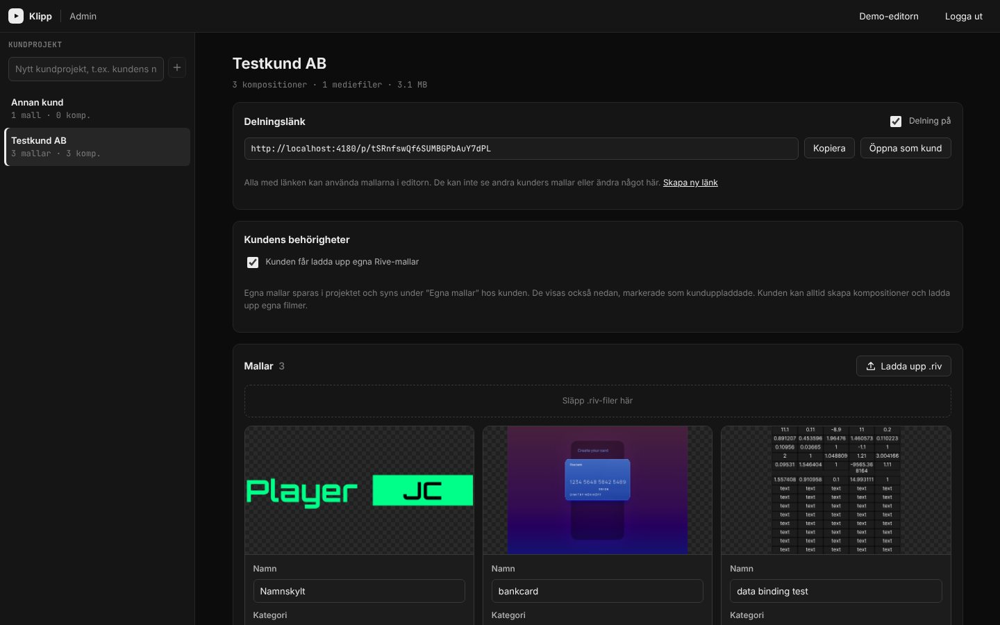
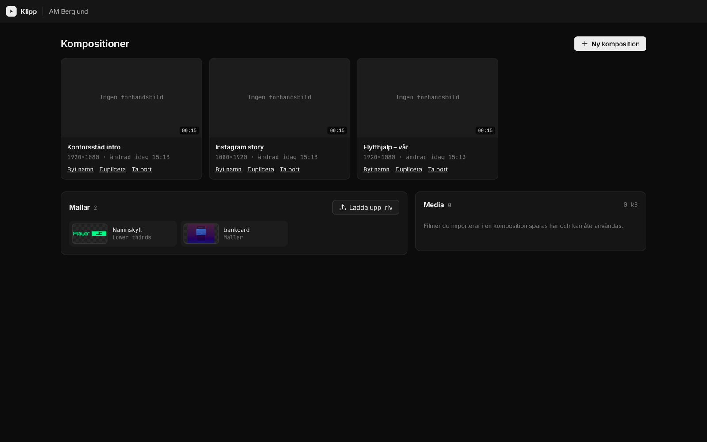
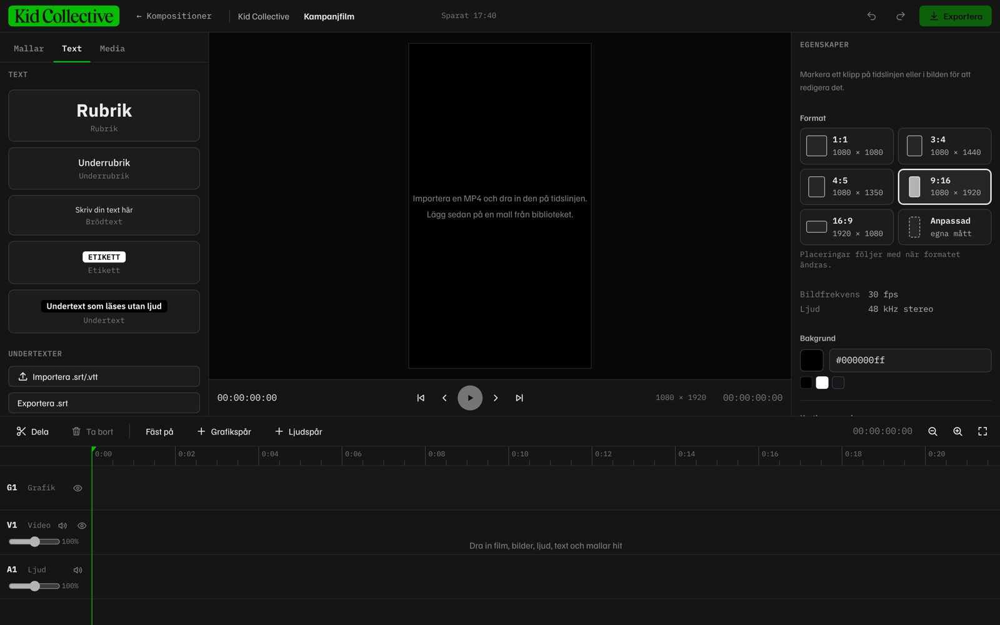
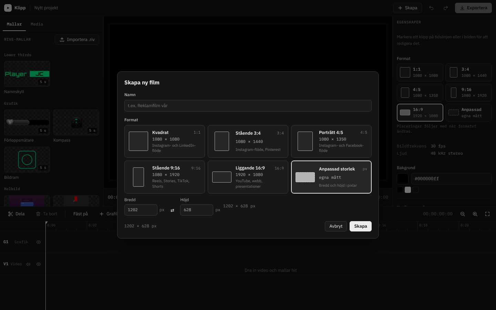
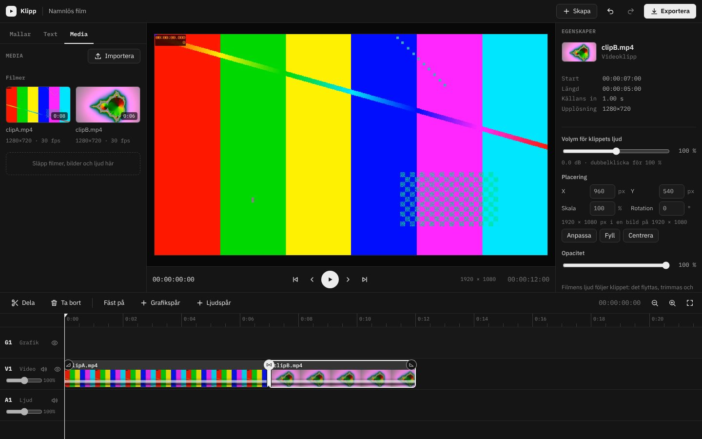
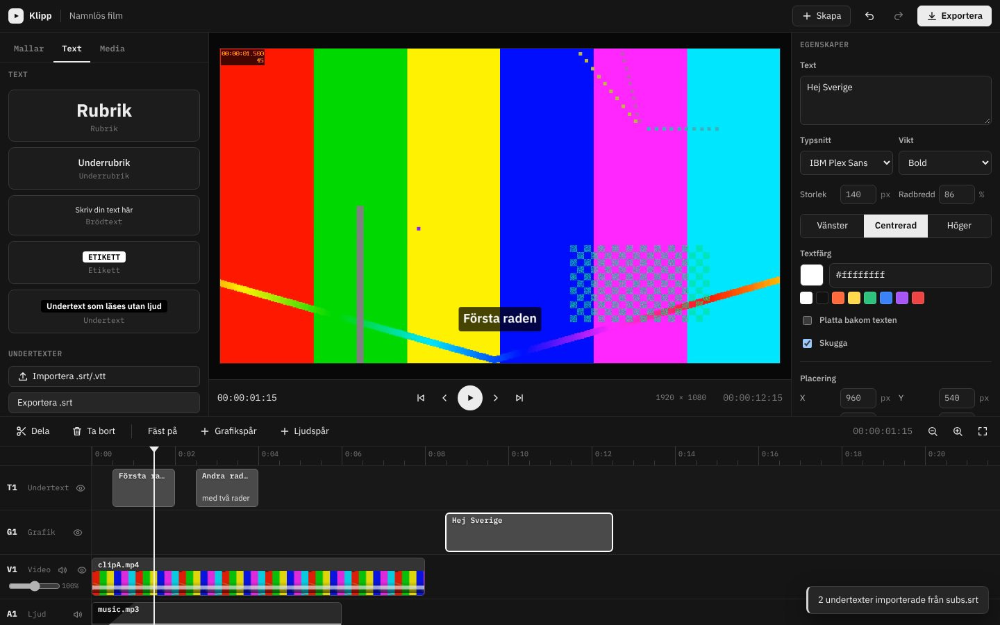

# Klipp – videoredigering med Rive-mallar i webbläsaren

En webbaserad videoredigerare där man klipper MP4-material och lägger på rörlig grafik från
**Rive-mallar** (ett öppet alternativ till MOGRT), med export till MP4. Allt körs lokalt i
webbläsaren. Ingen server och inget konto behövs.


## Kundprojekt, kompositioner och delningslänkar

**Admin** (`/admin`) skapar ett *kundprojekt* per kund, laddar upp kundens `.riv`-mallar och skickar
delningslänken (`/p/<nyckel>`) till kunden.



Per mall väljer du namn, kategori, artboard, placering i bilden, standardlängd och vilka fält kunden
ser och vad de heter. Under **Kundens behörigheter** bestämmer du om kunden får ladda upp egna
Rive-mallar. De hamnar då under "Egna mallar" och markeras som *Kunduppladdad* i admin. Du ser
också kundens kompositioner och hur mycket lagring de använder.

**Kunden** öppnar länken och kommer till sin **projekthanterare**:



- **Kompositioner:** varje komposition är en egen film med eget format (16:9, 9:16, 1:1, 4:5,
  4K eller "från första filmen"). Kompositioner kan skapas, öppnas, döpas om, dupliceras och tas bort.
- **Autosparning:** varje ändring sparas på servern efter en kort paus ("Sparat 14:32" i toppraden).
  Kunden kan stänga fliken, öppna länken senare, även på en annan dator, och fortsätta där hen slutade.
  Om samma komposition ändras i två fönster upptäcks det (versionsnummer) och kunden får välja version.
- **Projektets media:** filmer som kunden importerar laddas upp till projektet (med förloppsindikator)
  och kan återanvändas i alla kompositioner. Editorn läser dem med HTTP range-requests, så stora filer
  behöver inte laddas ner i sin helhet för att spelas upp eller exporteras.
- **Mallar:** projektets mallar, och kundens egna om admin tillåter det.

Delningslänken kan stängas av eller bytas ut. Då slutar den gamla fungera direkt, även för öppna
kompositioner. Kunden kan inte se andra kunders mallar, media eller kompositioner och kan inte nå admin-API:t.


### Kundens utseende

Under **Utseende för kunden** i admin får varje kundprojekt sin egen profil på kundens sidor, alltså
projekthanteraren och editorn:

- **Accentfärg** för knappar, markeringar och fokus. Texten på knapparna blir automatiskt svart
  eller vit beroende på vad som är mest läsbart. Är färgen för mörk mot bakgrunden får knapparna
  färgen, men markeringar och fokusramar behåller en ljus ton så att de syns. Admin får en varning.
- **Typsnitt** för rubriker och för text: ett förval (IBM Plex Sans, IBM Plex Mono,
  systemets typsnitt eller serif) eller kundens eget typsnitt som WOFF2, WOFF, TTF eller OTF.
  Kontrollera att licensen tillåter webbanvändning.
- **Logotyp** som SVG, PNG, JPEG eller WebP. Den ersätter Klipps märke uppe till vänster och
  används som ikon i webbläsarfliken.

- **Platta bakom logotypen**: ingen, accentfärg eller vit. Används när logotypen är mörk och
  annars inte skulle synas mot det mörka gränssnittet.

Kundens egna typsnitt får sina riktiga vikter om filen är ett variabelt typsnitt. Annars gör
webbläsaren fet stil själv.

En förhandsvisning i admin visar resultatet direkt. Adminsidorna och andra kunder påverkas inte.
Filerna lagras i projektet och tas bort när de byts ut eller när kundprojektet tas bort.

### Kundprofiler i repot

En kundprofil kan sparas som en mapp under `customers/` och läggas in på en server med ett kommando.
Mappen innehåller `profile.json` (namn, accentfärg, logotyp, platta och typsnitt) och filerna den
pekar på. `customers/kid-collective/` är ett exempel:

```bash
ADMIN_PASSWORD='…' pnpm customer customers/kid-collective --url https://din-server
```

Kommandot skapar kundprojektet om det inte finns, annars uppdateras det (det känns igen på namnet).
Sist skrivs kundens delningslänk ut. Standardadressen är `http://localhost:8787`.



## Gränssnitt

Gränssnittet är helt i gråskala: hierarkin kommer från ljushet, vikt och typsnitt, inte färg.
Typsnittsfamiljen är **IBM Plex**: Plex Sans för text och Plex Mono för tidskoder, mått, siffror,
filnamn, etiketter och metadata. Båda bäddas in i appen (SIL Open Font License) och hämtas inte från
externa tjänster.

## Funktioner i editorn

### Skapa: format

**Skapa** öppnar ett val av format i full upplösning:

| Format | Pixlar | Passar till |
|---|---|---|
| 1:1 Kvadrat | 1080 × 1080 | Instagram- och LinkedIn-flöde |
| 3:4 Stående | 1080 × 1440 | Instagram-flöde, Pinterest |
| 4:5 Porträtt | 1080 × 1350 | Instagram- och Facebook-flöde |
| 9:16 Stående | 1080 × 1920 | Reels, Stories, TikTok, Shorts |
| 16:9 Liggande | 1920 × 1080 | YouTube, webb, presentationer |
| Anpassad storlek | egna mått | 128–4096 px per sida, avrundas till jämna pixlar (krav för H.264) |



Formatet kan bytas i efterhand i egenskapspanelen (när inget klipp är markerat). Placeringar sparas
relativt bildrutan och följer därför med vid formatbyte.

### Flytta, skala och rotera

Filmer, bilder och mallar kan flyttas och skalas direkt i förhandsvisningen. Klicka på ett lager för
att markera det, dra för att flytta och dra i hörnen för att skala. Filmer och bilder roteras med
handtaget ovanför. Lager fäster mot bildens mitt och kanter, och skalan fäster vid *Anpassa* och
*Fyll*; håll **Shift** för att stänga av fästningen. Exakta värden (X, Y i pixlar, skala i %,
rotation i °) och knapparna **Anpassa**, **Fyll** och **Centrera** finns i egenskapspanelen.

### Bilder

PNG, JPEG och WebP kan importeras och läggas in i filmen som egna klipp, till exempel logotyper.
Genomskinlighet bevaras. Bilder flyttas, skalas, roteras, tonas (opacitet) och trimmas som andra klipp.
I kundprojekt sparas bilderna i projektets media och kan återanvändas.

### Vektorgrafik

**SVG, PDF, Illustrator (.ai) och EPS** kan importeras som grafik. Genomskinliga ytor i filen
förblir genomskinliga, så filmen syns igenom. Grafiken blir aldrig en bild med fast upplösning:
varje gång den visas större eller mindre ritas den om i exakt den storleken, och bara den del som
syns i bilden ritas. Kanterna är därför skarpa vid alla skalor, både i förhandsvisningen och i
exporten. I förhandsvisningen visas närmaste rendering direkt medan den skarpa tas fram.

- SVG ritas med webbläsarens egen SVG-motor. Skript och `<foreignObject>` tas bort.
- PDF och Illustrator ritas med pdf.js (första sidan). Illustrator-filer måste vara sparade med
  "Skapa PDF-kompatibel fil", vilket är standard. Annars får användaren ett tydligt felmeddelande.
- EPS (PostScript) kan webbläsare inte läsa. Servern konverterar filen till PDF med Ghostscript
  när den laddas upp till ett kundprojekt, så den förblir vektorgrafik.

### Ljud

- **Egna ljudfiler:** MP3, WAV, M4A/AAC, Ogg/Opus och FLAC importeras som filmer och bilder
  och läggs på **ljudspår** (A1, A2 …) under bildspåren. Lägg till fler med **+ Ljudspår**.
- **Filmens ljud följer klippet:** det flyttas, trimmas och delas tillsammans med bilden.
- **Volym per klipp:** 0–200 %, med dB-visning; dubbelklicka på reglaget för 100 %.
- **Volym per spår:** reglaget i spårhuvudet gäller alla klipp på spåret, för både video- och
  ljudspår. Slutlig nivå = klippvolym × spårvolym. Högtalarknappen stänger av spåret.
- **Ljudvågor** visas på ljudklipp och under filmklipp. De beräknas en gång per fil i bakgrunden.
- Förhandsvisning och export använder samma volymkurva. E2e-testet mäter exporten och kontrollerar
  att 50 % klippvolym ger −6,02 dB och 25 % spårvolym −12,0 dB.

### Text och undertexter

- Fliken **Text** har förval: Rubrik, Underrubrik, Brödtext, Etikett och Undertext. Dra in ett
  förval eller klicka **+**.
- Textklipp har typsnitt (IBM Plex Sans/Mono), vikt, storlek i px, färg, justering, radbredd, platta
  bakom texten, skugga och opacitet. De kan flyttas, skalas och roteras som andra lager.
  Storleken är relativ till bildhöjden, så texten ser likadan ut i alla upplösningar.
- **Undertexter:** importera `.srt` eller `.vtt`. Varje rad blir ett redigerbart textklipp på ett
  eget undertextspår. **Exportera .srt** skriver ut dem igen, till exempel för uppladdning på YouTube.
- *Förberett:* automatisk undertextning (tal till text) kan läggas in på samma sätt som en
  importerad `.srt`, så resten av flödet är redan klart.

### Övergångar

Övergångar är **valbara** och finns inte på några klipp från början. När muspekaren förs över ett
spår visas en övergångsknapp

- **där två klipp möts:** skapar en **övertoning** mellan klippen. Båda klippkanterna markeras när
  knappen hålls över. Övertoningen är centrerad på skarven: det utgående klippet fortsätter och det
  inkommande börjar tidigare, och ljudet tonas över på samma sätt.
- **i början eller slutet av ett klipp** (utan grannklipp): skapar en **toning från/till svart**.
  Ljudet tonas från och till tystnad.

Standardlängden är 1 s. Övergången syns som en randig markör på klippen. Klicka på den för att
ändra längden (0,5 s, 1 s, 2 s eller valfritt) eller ta bort den, eller tryck **Delete**/**Backspace**.

Om klippen redan använder början eller slutet av sina filer finns inget extra material att tona över
med. Bilden håller då första eller sista bildrutan, och ljudet tonas ner till skarven och upp från
den, så att ingenting klipps av tvärt.

En övertoning hör till de två klipp den skapades mellan. Flyttas ett av dem bort slutar den gälla,
och den hamnar aldrig av sig själv mellan andra klipp, till exempel när ett klipp tas bort och
luckan stängs. Flyttas klippet tillbaka finns övertoningen kvar. Ett fullskärmsklipp ligger kvar
till 100 % under det inkommande klippet. Ett mindre, flyttat eller genomskinligt lager, en bild,
en text eller en mall tonas samtidigt ut, så att det aldrig försvinner med ett hopp.



### Ta bort

Markera ett klipp eller en övergång och tryck **Delete** eller **Backspace**. Med **Shift** stängs
luckan efter ett borttaget klipp. **⌘/Ctrl+Z** ångrar.



### Övrigt

- **Import** av MP4 (H.264/AAC och det webbläsaren kan avkoda), bilder och egna `.riv`-mallar.
  Filer kan släppas var som helst i fönstret.
- **Tidslinje** med video- och grafikspår: dra in klipp, flytta, trimma, dela (`S`), ta bort
  (`Delete`, med `Shift` stängs luckan), fäst mot kanter och spelhuvud, zoom, och dölj eller tysta spår.
- **Mallbibliotek** med tumnaglar och live-förhandsvisning när muspekaren förs över en mall.
  Mallar dras in på tidslinjen eller läggs vid spelhuvudet med `+`.
- **Egenskapspanel** som byggs automatiskt från mallens View Model (data binding): text, färg
  (med projektets palett), bild, tal, av/på och val.
- **Förhandsvisning** med ljud, där ljudklockan styr uppspelningen. **Mellanslag** spelar upp från
  tidsmarkören och pausar där den står. Nästa tryck fortsätter därifrån. Flyttas markören under
  uppspelning fortsätter uppspelningen från den nya platsen.
- **Ångra och gör om** för allt (`⌘/Ctrl+Z`, `⌘/Ctrl+Shift+Z`). Skrivande i ett fält blir ett enda steg.
- **Export** till MP4 (H.264 + AAC 48 kHz stereo) i en Web Worker, med förlopp och möjlighet att
  avbryta. Exporten använder exakt samma renderingsfunktion som förhandsvisningen.

## Kom igång

Kräver Node 22.18 eller senare (kör TypeScript och SQLite inbyggt) och pnpm.

```bash
cd video-editor
pnpm install
pnpm dev          # editor på http://localhost:5173, API på :8787 (lösenord "admin" i utveckling)
```

| Adress | Vad |
|---|---|
| `/` | Demo-editorn med exempelmallar |
| `/admin` | Admin: kundprojekt, mallar, behörigheter och delningslänkar |
| `/p/<nyckel>` | Kundens projekthanterare (kompositioner, mallar, media) |
| `/p/<nyckel>/c/<id>` | Editorn för en komposition (sparas automatiskt) |

Övriga kommandon:

| Kommando | Vad |
|---|---|
| `pnpm build` | Produktionsbygge av gränssnittet till `apps/editor/dist` |
| `pnpm start` | Servern: API och det byggda gränssnittet i en process |
| `pnpm test` | Enhetstester (Vitest): datamodell, mallar och API |
| `pnpm typecheck` | TypeScript, strikt läge |
| `pnpm e2e` | End-to-end i Chromium: editorn, admin→kund, format/placering och ljud/text, med mätning av den exporterade filen (kräver `pnpm build`, Playwright och ffmpeg) |

Webbläsare: Chromium-baserad (Chrome/Edge) med WebCodecs, OffscreenCanvas och WebGL2.

## Drift

```bash
pnpm install --frozen-lockfile && pnpm build
NODE_ENV=production ADMIN_PASSWORD='…minst 12 tecken…' DATA_DIR=/var/lib/klipp pnpm start
```

| Variabel | Standard | Beskrivning |
|---|---|---|
| `ADMIN_PASSWORD` | – (krävs i produktion) | Lösenordet till `/admin` |
| `PORT` | `8787` | |
| `DATA_DIR` | `video-editor/.data` | SQLite-databas och uppladdade filer. Måste ligga på en beständig disk |
| `COOKIE_SECURE` | `true` i produktion | Sätt `false` bara om du kör utan HTTPS lokalt |
| `TRUST_PROXY` | `false` | `true` bakom en proxy, så att inloggningsspärren ser rätt IP |
| `MAX_UPLOAD_MB` | `25` | Största tillåtna .riv-fil |
| `MAX_MEDIA_MB` | `2048` | Största film/bild en kund kan ladda upp |
| `WORKSPACE_QUOTA_MB` | `20480` | Total lagring för media per kundprojekt |
| `SESSION_DAYS` | `7` | Hur länge en admininloggning gäller |
| `GHOSTSCRIPT` | `gs` | Ghostscript för att konvertera EPS till PDF. Tom sträng stänger av EPS |

EPS-stöd kräver Ghostscript på servern (`apt-get install ghostscript`). Uppladdade filer skickas
med en Content-Security-Policy som gör att de aldrig kan köras som webbsidor.

Kör bakom HTTPS. Säkerhetskopiera `DATA_DIR`.

## Arkitektur

```
packages/
  core/     Datamodell, tidsmatematik, redigeringsoperationer, ångra/gör om, malltiming. Inga DOM-beroenden.
  media/    mediabunny: öppna MP4, bildrutor (VideoFrameReader), ljudmix för export, ljud för förhandsvisning
  rive/     Rive-runtime, inläsning och inspektion av mallar, TemplateRenderer
  render/   WebGL2-kompositor och renderFrame(projekt, bildruta), gemensam för förhandsvisning och export
  export/   Export-worker (rendera → H.264, mixa → AAC, muxa → MP4) och klient-API
apps/
  editor/   React + Zustand (bibliotek, viewer, egenskapspanel, tidslinje, export) och admin (/admin)
  server/   Hono + node:sqlite: kundprojekt, mallar, kompositioner, media (range-requests),
            delningslänkar och admininloggning; filer lagras innehållsadresserat på disk
```

Principer:

1. **En renderingsväg.** `renderFrame(project, frame)` ritar bildrutor både i förhandsvisningen och
   i exporten, så exporten ser ut som det man såg.
2. **Projektet är data.** Versionerad JSON utan referenser till webbläsarobjekt. Alla operationer
   är rena funktioner (`Project → Project`), vilket ger billiga ögonblicksbilder för ångra/gör om.
3. **Heltalstid.** Tidslinjen räknar i bildrutor och källmaterialet i mikrosekunder, så att
   ingen drift uppstår.
4. **Tungt arbete utanför UI-tråden.** Exporten körs i en Web Worker med OffscreenCanvas.
5. **Förberett för keyframes.** Alla värden är `Param<T>` och läses via `evaluateParam()`.
   Keyframes blir en ny variant av `Param` utan ändringar i renderare eller export. Övergångar blir
   egna objekt mellan klipp, och kompositorn kan redan blanda lager med opacitet.

## Mallar

Se [docs/mallar.md](docs/mallar.md) för hur en mall byggs i Rive (View Model, in/hold/out,
manifest). Demomallarna i `apps/editor/public/templates` är testfiler från Rives öppna runtime
(MIT-licens) och ska ersättas med egna.

## Kända begränsningar och nästa steg

- Kompositioner sparas bara för kunder (via delningslänk). Demo-editorn på `/` sparar ingenting.
- Ingen offline-cache: en återöppnad komposition strömmar filmerna från servern. En lokal cache (OPFS)
  skulle göra scrubbning snabbare på långsamma anslutningar.
- Tar kunden bort en film från projektets media visas klipp som använder den som saknade.
- En enda admin (ett lösenord). Flera administratörer med egna konton kan läggas till senare.
- Delningslänken fungerar som en nyckel: alla som har den kommer åt projektets mallar, kompositioner och
  filmer. Byt länk i admin om den sprids.
- Tar admin bort en mall som kunden har lagt på tidslinjen visas klippet som saknat.
- Rive-mallar med **ljud** stöds inte i exporten.
- Volym och opacitet är fasta per klipp (plus toningar). Volymkurvor med nyckelbildrutor och automatisk
  sänkning av musik under tal (ducking) är nästa steg; datamodellen är förberedd (`Param`).
- Endast MP4 in och ut. Fler format kan läggas till senare i `media`-paketet; mediabunny stöder
  redan WebM, MOV med flera.
- Firefox och Safari är inte testade.
- Ingen proxy-redigering: 4K-material med många spår kan bli tungt i förhandsvisningen.
- Formatet väljs när kompositionen skapas, eller i projektinställningarna (klicka i tomrummet på tidslinjen).
  Video skalas in med svarta kanter, och placering per klipp kommer senare.
